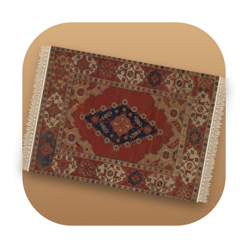
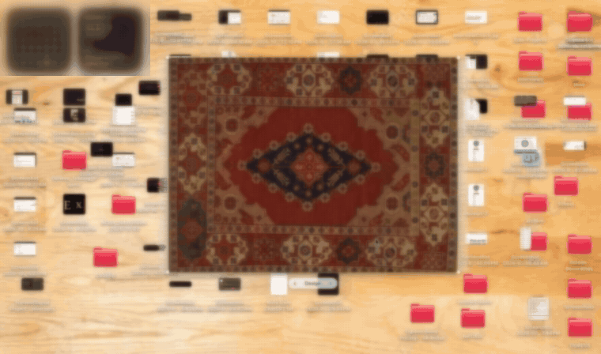

<br />
<p align="center">
  
</p>

<h1 align="center">Underrug</h1>

<p align="center">
  A rug for your Mac desktop. Sweep your mess under it.
  <br />
  <br />
  <a href="https://github.com/sinhaarya04/underrug/releases"></a>
  <a href="https://github.com/sinhaarya04/underrug/actions/workflows/build.yml"></a>
  
  <a href="LICENSE"></a>
</p>

<br />

<p align="center">
  
  <br />
  <sub><a href="./docs/demo.mp4">Watch at full speed (MP4)</a></sub>
</p>

## 🌟 Features

- **A real rug.** Eight antique carpets photographed by The Met (public domain), each at its true proportions, or
  weave in your own image.
- **Sweep it under the rug.** Every desktop icon, just a Finder selection, or icons you drop on the rug, piled into
  one messy heap underneath. Only icon positions change, never your files.
- **Peek underneath.** Drag an edge and the rug turns back on itself like fabric; let go and it falls flat.
- **Put the icons back.** Every swept icon returns to exactly where it was.
- **Make it yours.** Drag to move, corner dots to rotate, pinch to resize, and a Design pill to flip through rugs.
- **See through it.** Hold ⌥ and the rug fades so you can click what's under it.
- **Stays out of the way.** It sits below every window, only takes the mouse over the rug, and idles at ~0% CPU.

## 📦 Install

**Download:** grab `Underrug.zip` from the [latest release](https://github.com/sinhaarya04/underrug/releases/latest),
unzip it and move `Underrug.app` to Applications.

Underrug isn't notarized yet, so the first time, right-click the app and choose **Open** (or run
`xattr -dr com.apple.quarantine /Applications/Underrug.app`).

**Build from source** (needs only Apple's Command Line Tools):

```sh
git clone https://github.com/sinhaarya04/underrug.git && cd underrug
./build.sh
open build/Underrug.app
```

Requires macOS 13 Ventura or later, on Apple silicon or Intel.

## ⚡️ Usage

Underrug lives in the menu bar. Everything is also on the rug's right-click menu.

| To… | Do this |
|---|---|
| Move the rug | Drag it |
| Peek underneath | Drag an edge, then let go |
| Rotate | Drag a corner dot, or scroll over the rug |
| Resize | Pinch over the rug, or **Size ▸ Bigger / Smaller** |
| Change the rug | The **‹ Design ›** pill under it, or **Design** in the menu |
| See through it | Hold **⌥** |
| Sweep everything under | **Sweep N Icons Under the Rug** |
| Sweep some icons | Select them and drop them on the rug, or **Sweep Selected Icons Under the Rug** |
| Undo a sweep | **Put the Icons Back** |

### Permissions

- **Finder (Automation).** Asked on your first sweep. Underrug uses it to read and set icon positions; without it,
  nothing can move.
- **Desktop folder (optional).** Only used to show how many icons a sweep will take. Sweeping works without it.

If Finder's desktop **Sort By** or **Use Stacks** is on, Finder keeps its own order and ignores new positions.
Underrug notices and tells you; set *Sort By* to *None* and turn off *Use Stacks* to sweep.

Underrug never moves, renames or deletes files and makes no network connections. See [SECURITY.md](SECURITY.md).

## 🛠️ How it works

The rug is a transparent window just above the desktop icons and below everything else. It's drawn with Core Graphics:
a peel mirrors the lifted part of the rug across the crease and shades it as the rug's underside. Sweeping asks Finder
for every icon's position, saves them, and lays the icons out in a jumbled heap inside the rug's footprint.

Want to dig in? Start with [CONTRIBUTING.md](CONTRIBUTING.md#code-structure).

## 🤝 Contributing

Bug reports, ideas and new rug designs are all welcome. Please read [CONTRIBUTING.md](CONTRIBUTING.md) and the
[Code of Conduct](CODE_OF_CONDUCT.md) first.

## 🙏 Credits

Rug photographs: [The Metropolitan Museum of Art](https://www.metmuseum.org), Open Access (CC0). Each one is listed
in [CREDITS.md](CREDITS.md).

## 📃 License

[MIT](LICENSE). The rug photographs are public domain and not covered by the license.
